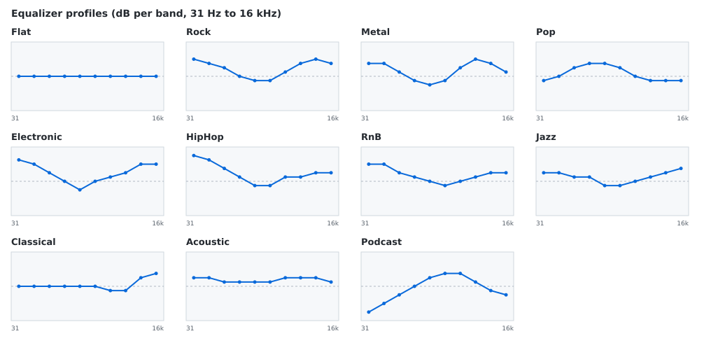

# spotify-autoeq

[English README](README.md)

Spotify'da çalan şarkının türüne göre Linux ekolayzırınızı otomatik değiştirir.
Rock'ta bas ve tiz artar, podcast'te ses netleşir, Spotify kapanınca her şey
düz (Flat) profile döner.


Sürüm 1.0.0. Linux, PulseAudio, PulseEffects 4.8.

## Nasıl çalışır

1. `playerctl --follow` Spotify şarkı değişimlerini MPRIS üzerinden bildirir.
   Yoklama (polling) yoktur; servis yalnızca şarkı değişince uyanır.
2. Kısa bir bekleme (1,5 sn, yani şarkı atlarken hiçbir şey tetiklenmez)
   sonrası sanatçının türleri aranır: önce yerel SQLite önbelleği, sonra
   MusicBrainz, iTunes ve Deezer (anahtar tanımlarsanız Last.fm).
3. Türler, bir anahtar kelime haritasıyla (`genre_map.yaml`, kolayca
   düzenlenir) on bir profilden biri için oy kullanır. Öndeki türlerin ağırlığı
   daha yüksektir.
4. Profilin 10 bantlı eğrisi GSettings üzerinden PulseEffects'e yazılır. Profil
   zaten aktifse hiçbir komut gönderilmez.


Güvenebileceğiniz davranışlar:

- Duraklatma, devam etme ve ileri/geri sarma arama veya ekolayzır değişikliği
  tetiklemez.
- Şarkıları hızlı atlarsanız yalnızca sonuncunun profili uygulanır. Şarkı
  değiştikten sonra biten arama atılır.
- Reklamlarda ekolayzıra dokunulmaz; podcast bölümleri Podcast profilini kullanır.
- Spotify kapanınca ekolayzır Flat'e döner.
- PulseEffects kullanılamazsa servis hatayı loglar ve çalışmaya devam eder; bir
  sonraki şarkıda yeniden dener.
- Eğrideki en büyük artış kadar giriş kazancı düşürülür, böylece yükseltilmiş
  profiller bozulma (clipping) yapmaz.

## Profiller



Flat, Rock, Metal, Pop, Electronic, HipHop, RnB, Jazz, Classical, Acoustic ve
Podcast. Eğriler bilerek ölçülü tutuldu; büyük yükseltmelerin yalnızca bozulma
eklediği Bluetooth kulaklıklar için ayarlandılar.

## Gereksinimler ve desteklenen sistemler

| Sistem | Durum |
|---|---|
| Ubuntu 22.04 LTS (PulseAudio, PulseEffects 4.8.4, Python 3.10) | Test edildi |
| 22.04 tabanlı dağıtımlar (Linux Mint 21 vb.) | Çalışması beklenir, test edilmedi |
| Ubuntu 24.04 LTS | Test edilmedi. Paket var (PulseEffects 4.8.7) ama varsayılan ses sunucusu PipeWire'dır ve desteklenmez; yalnızca gerçek PulseAudio kullanıyorsanız çalışabilir |
| Ubuntu 20.04 ve eski | Desteklenmez (Python 3.10'dan eski) |

Gerekenler:

- Ses sunucusu olarak PulseAudio (PipeWire'da olup olmadığınızı `spotify-autoeq doctor` söyler)
- PulseEffects 4.8.x, `playerctl`, `lsp-plugins-lv2` (PulseEffects'in kullandığı
  ekolayzır motoru), `python3-gi`, `python3-yaml`
- Python 3.10 veya üzeri
- Spotify masaüstü istemcisi (MPRIS adı `spotify` olan her paketleme)

```
sudo apt install --no-install-recommends pulseeffects playerctl lsp-plugins-lv2 python3-gi python3-yaml
```

## Kurulum

Kurulum kullanıcı bazlıdır: root gerektirmez, sistem dizinlerine veya ses
sunucusu ayarlarına dokunmaz. Sisteminizi istediğiniz zaman
`spotify-autoeq doctor` ile kontrol edebilirsiniz.

### Önerilen: pipx

```
sudo apt install pipx
pipx install --system-site-packages spotify-autoeq
pipx ensurepath          # yalnızca ilk seferde, sonra yeni bir terminal açın
spotify-autoeq doctor
```

`--system-site-packages` gereklidir; program sistemin PyGObject'ini
(`python3-gi`) kullanır. pipx istemezseniz düz bir sanal ortam da olur:

```
python3 -m venv --system-site-packages ~/.local/share/spotify-autoeq
~/.local/share/spotify-autoeq/bin/pip install spotify-autoeq
```

### Kaynak klasöründen

```
git clone <depo-adresi> spotify-autoeq
cd spotify-autoeq
packaging/install.sh cli        # veya: packaging/install.sh service
```

### Nasıl çalışacağını seçin

**A. Terminalden kendiniz çalıştırın.** Arka planda hiçbir şey çalışmaz,
oturum açılışında hiçbir şey başlamaz. Denemek için idealdir.

```
spotify-autoeq run              # Ctrl+C durdurur
```

**B. Servis olarak kurun ve unutun.** Bir systemd kullanıcı servisi her oturum
açılışında başlar ve hata verirse kendini yeniden başlatır.

```
spotify-autoeq service install
journalctl --user -u spotify-autoeq -f          # canlı log
systemctl --user stop spotify-autoeq            # bu oturum için durdur
spotify-autoeq service uninstall                # servisi tekrar kaldır
```

(Kaynak klasöründe `packaging/install.sh service` kurulum ve bu adımı tek seferde
yapar.) Servis durunca `pulseeffects --quit` çalışır ve ses akışları doğrudan
çıkış cihazınıza döner.

### Güncelleme

```
pipx upgrade spotify-autoeq
systemctl --user restart spotify-autoeq         # yalnızca servis kullanıyorsanız
```

Kaynak klasöründe: son sürümü çekip `packaging/install.sh` komutunu aynı modla
yeniden çalıştırın.

## Kaldırma

```
spotify-autoeq service uninstall                # servis kurduysanız
pipx uninstall spotify-autoeq                   # veya: packaging/install.sh uninstall
rm -r ~/.config/spotify-autoeq ~/.cache/spotify-autoeq    # isteğe bağlı: ayar ve tür önbelleği
```

Program, çalışırken yazdığı ekolayzır değerleri dışında PulseEffects ayar
dosyalarınızı değiştirmez; geri alınacak başka bir şey yoktur. Paketlerin
kendisini kaldırmak için:

```
sudo apt remove pulseeffects playerctl lsp-plugins-lv2
```

`packaging/install.sh uninstall --purge`, kaynak klasörü kurulumunun ayar ve
önbellek dahil her şeyini kaldırır.

## Komutlar

```
spotify-autoeq run                            # Spotify'ı ön planda izler
spotify-autoeq resolve "Oasis" "Wonderwall"   # türleri ve seçilen profili gösterir
spotify-autoeq status                         # şarkı, önbellek kaydı, PulseEffects durumu
spotify-autoeq doctor                         # tüm gereksinimleri çözüm önerisiyle denetler
spotify-autoeq config init                    # düzenlemek için açıklamalı ayar dosyası yazar
spotify-autoeq service install|uninstall      # systemd kullanıcı servisini yönetir
spotify-autoeq --version
```

`SIGHUP`
ayarı yeniden başlatmadan yükler; `SIGTERM` veya `Ctrl+C` temiz kapatır.

## Ayarlar

İsteğe bağlı dosya: `~/.config/spotify-autoeq/config.yaml`
(`spotify-autoeq config init`, tüm anahtarları içeren
[açıklamalı bir örnek](src/spotify_autoeq/apps/autoeq/data/config.example.yaml) yazar).

| Anahtar | Varsayılan | Anlamı |
|---|---|---|
| `player` | `spotify` | MPRIS oynatıcı adı |
| `debounce_s` | `1.5` | Şarkı değişiminden sonra aramadan önceki bekleme |
| `logging.level` | `INFO` | `DEBUG` atlanan tekrarları ve önbellek isabetlerini gösterir |
| `resolver.providers` | `musicbrainz, itunes, deezer` | Arama sırası; `lastfm` için `lastfm_api_key` gerekir |
| `resolver.http_timeout_s` | `4.0` | İstek başına zaman aşımı |
| `resolver.positive_ttl_days` / `negative_ttl_days` | `30` / `1` | Bulunan / bulunamayan sonuçların önbellek ömrü |
| `mapper.default_profile` | `Flat` | Hiçbir tür eşleşmezse kullanılır |
| `mapper.overrides` | yok | `"sanatçı"` veya `"sanatçı - şarkı"` için sabit profil |

Örnek:

```yaml
mapper:
  overrides:
    "Sezen Aksu": Acoustic
    "Daft Punk - Veridis Quo": Classical
```

Hangi tür kelimesinin hangi profili seçtiğini değiştirmek için
`src/spotify_autoeq/modules/preset_mapper/genre_map.yaml` dosyasını düzenleyip
yeniden kurun.

## Gizlilik

Tür bulmak için sanatçı adı (iTunes ve Deezer için şarkı adı da) MusicBrainz,
iTunes ve Deezer'a gönderilir. Sonuçlar yerelde
`~/.cache/spotify-autoeq/genres.sqlite3` içinde önbelleğe alınır; her sanatçı
ayda yaklaşık bir kez sorgulanır. Başka hiçbir şey makinenizden çıkmaz, hesap
veya anahtar gerekmez.

## Sınırlamalar

- PulseEffects 2020'den beri bakım görmüyor. Bu proje onun 4.8.4 sürümünü ve
  PulseAudio'yu hedefler. PipeWire'da EasyEffects kullanın; burada desteklenmez.
- PulseEffects yalnızca Spotify'ı değil, tüm uygulamaların sesini işler.
- Profil değişirken filtreler yeniden kurulduğu için çok kısa bir tıklama
  olabilir.
- Tür verisi herkese açık veri tabanlarından gelir; küçük sanatçılarda kaba veya
  yanlış olabilir. Düzeltmek için `mapper.overrides` kullanın.
- Yalnızca Spotify izlenir.

## Geliştirme

```
python3 -m venv --system-site-packages .venv
.venv/bin/pip install -r requirements.txt
.venv/bin/python -m pytest
```

Testler ağ gerektirmez: sağlayıcılar kayıtlı JSON yanıtlarını kullanır, uçtan uca
testler gerçek komut satırını sahte `playerctl` ve `pulseeffects` dosyalarıyla,
`GSETTINGS_BACKEND=memory` altında çalıştırır; ses ayarlarınıza veya sistem
ayarlarınıza dokunulmaz.

Kurmadan, kaynak klasörden çalıştırmak için:

```
PYTHONPATH=src .venv/bin/python -m spotify_autoeq.apps.autoeq run
```

Bu belgedeki görseller `docs/make_assets.py` ile üretilir (terminal animasyonu,
gerçek bir oturumdan alınan `docs/assets/session.log` kaydının
yeniden oynatımıdır).

Yapı:

```
src/spotify_autoeq/
  modules/media_listener/   playerctl denetçisi, şarkı olayları
  modules/genre_resolver/   önbellek ve çevrimiçi sağlayıcılar
  modules/preset_mapper/    tür -> profil oylaması
  modules/eq_controller/    profiller ve PulseEffects arka ucu
  apps/autoeq/              ayar, daemon, komut satırı, doctor, servis birimi
packaging/                  kaynak klasörü için kurucu
```

## Lisans

MIT, bkz. [LICENSE](LICENSE). Değişiklikler [CHANGELOG.md](CHANGELOG.md)
dosyasındadır.
